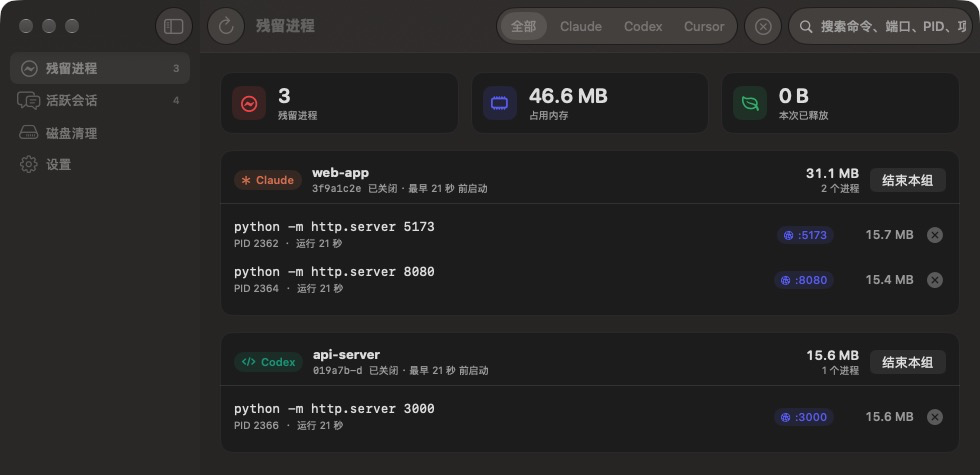

# Reap

Clean up the leftover processes and disk clutter that AI coding tools leave behind. Supports Claude Code, Codex, and Cursor on macOS and Windows.

Agents like Claude Code and Codex happily spin up dev servers, file watchers, and browsers. When the session ends, those processes often keep running in the background, holding memory and ports, while worktrees and temp files pile up. Reap lives in your menu bar (system tray on Windows) and helps you find and clean them up.



## Download

Grab the latest build from [Releases](https://github.com/thelifeofgame/reap/releases/latest):

| Platform | File | Requirements |
| --- | --- | --- |
| macOS | `Reap-<version>-macos.dmg` (universal: Apple silicon and Intel) | macOS 14 or later |
| Windows x64 | `Reap-Setup-<version>-x64.exe` installer, or `Reap-<version>-x64.zip` portable | Windows 10 1809 or later |
| Windows ARM | `Reap-Setup-<version>-arm64.exe`, or `Reap-<version>-arm64.zip` | Windows 10 1809 or later |

**First launch says "cannot verify the developer" (macOS)**: the app is not notarized yet. Open the DMG, drag Reap into Applications, then right-click Reap in Finder and choose Open. If macOS says the app is "damaged", run:

```bash
xattr -dr com.apple.quarantine /Applications/Reap.app
```

**Windows shows "Windows protected your PC"**: the installer is not code-signed yet. Click "More info", then "Run anyway". Installing does not require administrator rights.

## Features

- **Leftover processes**: finds processes still running in the background after their session was closed, grouped by session with memory usage and listening ports. End a whole group or everything in one click. Reap asks processes to quit first and only force-kills whatever is still alive after 2 seconds.
- **Active sessions**: lists running agent sessions and the background processes they started. You can auto-end Claude Code sessions that have been idle too long; the transcript is kept, so you can pick the conversation back up with `claude --resume`.
- **Disk cleanup**:
  - Git worktrees created by agents. Worktrees with uncommitted changes are moved to the Trash/Recycle Bin instead of being deleted; removing a worktree never deletes the branch.
  - Claude temp files and command output left behind by closed sessions.
  - Caches that get downloaded again automatically: npm, pnpm, Yarn, Gradle, Cargo, pip, uv, Go, and more.
- **Menu bar / tray**: shows how much memory leftover processes are using, with an option to launch at login.

## How Reap decides something is a leftover

| Agent | Detection |
| --- | --- |
| Claude Code | `CLAUDECODE` environment variable, session records, process groups |
| Codex | `CODEX_*` environment variables. Components of the Codex/ChatGPT app itself and your own browser are excluded |
| Cursor (experimental) | `CURSOR_AGENT=1`. Cursor has no public documentation, so detection may miss cases |

A process counts as a leftover only when it belongs to an agent and the agent that started it has exited. Processes and files you are actively using never show up in the cleanable list, and nothing is deleted or killed until you click. The full rules live in [spec/DETECTION.md](spec/DETECTION.md); macOS and Windows share the same rules and test cases.

## Privacy

Reap only reads processes and files on your machine. It does not use the network and never uploads anything.

## Building from source

macOS (requires Xcode 15+ or Swift 5.10+):

```bash
cd macos
swift test
scripts/build.sh      # produces build/Reap.app
scripts/make-dmg.sh   # produces build/Reap.dmg
```

Windows (requires the .NET 8 SDK; building the installer also needs Inno Setup 6):

```powershell
cd windows
pwsh scripts/publish.ps1 -Version 0.1.0 -Arch x64
```

## Releasing a new version

Push a tag starting with `v` and GitHub Actions builds the macOS and Windows installers and publishes them to Releases:

```bash
git tag v0.1.0
git push origin v0.1.0
```

## Feedback

If something is misjudged (a leftover is missing from the list, or something that should not be cleaned up shows up), or you want support for another agent, open an [issue](https://github.com/thelifeofgame/reap/issues). Adding an agent usually only requires editing [spec/agents.json](spec/agents.json) and adding a fixture.

## Credits

The process detection approach and disk cleanup rules were informed by [seshka](https://github.com/jigjoy-ai/seshka) (MIT).

## License

[MIT](LICENSE)
